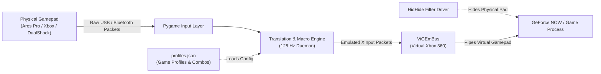

# GeForce NOW Controller Remapper PC

An advanced, low-latency Windows controller remapper and macro engine built specifically for cloud gaming (**NVIDIA GeForce NOW**) and native PC gaming. It intercepts raw gamepad inputs (XInput/DirectInput), maps them dynamically through custom per-game profiles, executes double-tap and multi-button combination macros, and streams inputs to a virtual Xbox 360 controller via the ViGEmBus driver.

---

## Key Highlights

- **Per-Game Profiles with Persistent Storage**: Select games from the left sidebar (*The Witcher 3*, *Cyberpunk 2077*, *Elden Ring*, or create custom game profiles). All button remaps and macros are saved permanently into `profiles.json`.
- **Advanced Macro Engine**:
  - **Double-Tap Macros**: Execute evasive dodges, sprints, or rapid-fire actions by double-tapping any button (e.g., double-tap `B` ➔ Dodge Roll).
  - **Multi-Button Combinations (Combos)**: Press and hold key combinations to trigger instant single-button or sequenced actions (e.g., `LB + X` ➔ Cast Sign `RT`, `Y + RB` ➔ Two-Hand Weapon).
- **Anti-Double Input Protection (Integrated HidHide)**: Completely hides the physical gamepad from GeForce NOW at the driver level, ensuring only the remapped virtual Xbox 360 controller registers.
- **125 Hz Translation Loop**: Sub-10ms response latency with normalized trigger gradients (`0.0` to `1.0`) and stick deadzone filtering.
- **Modern Dark UI**: Intuitive, high-contrast dark gamer theme built with PyQt6.

---

## System Architecture



---

## Getting Started

### 1. Prerequisites
- **Windows 10 / 11 (64-bit)**
- **Python 3.10+** (Tested on Python 3.12)
- **ViGEmBus Driver**: [ViGEmBus Releases](https://github.com/ViGEm/ViGEmBus/releases) *(Installs the system-level virtual controller bus)*
- **HidHide Driver (Optional but Recommended)**: [HidHide Releases](https://github.com/nefarius/HidHide/releases) *(Prevents double input on GeForce NOW)*

### 2. Installation
Clone the repository and install the dependencies:
```bash
git clone https://github.com/vivek3071997/controller_remapping_windows11_to_GeforceNOW.git
cd controller_remapping_windows11_to_GeforceNOW
pip install -r requirements.txt
```

### 3. Launching the App
Double-click `Launch Witcher Remapper.bat` on your Desktop, or run:
```bash
python witcher_remapper.py
```

---

## How to Use

1. **Select or Create a Game Profile**:
   - Choose a profile from the left sidebar or click `+ New Profile` to add your own game.
2. **Remap Any Button**:
   - Change any dropdown in the 16-button matrix (`Physical ➔ Target Output`).
3. **Add Powerful Macros**:
   - Click `+ Add Double-Tap Macro` to create actions triggered by rapid double clicks.
   - Click `+ Add Multi-Button Combo` to create complex actions fired by holding two buttons simultaneously.
4. **Save Profile**:
   - Click `💾 Save Profile` to write your configuration to `profiles.json`.
5. **Run Remapper**:
   - Click **▶ RUN REMAPPER**. The status bar will show active interception.
   - Launch NVIDIA GeForce NOW or your game and play with your custom controls!

---

## Automated GitHub CI/CD Build
A GitHub Actions workflow (`.github/workflows/build.yml`) automatically builds standalone Windows executable binaries on every release and commit to `main`.
